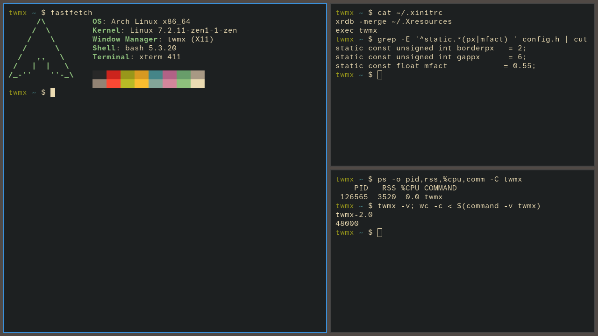

# twmx

A small, fast tiling window manager for X11, grown out of Nick Welch's
[TinyWM](http://incise.org/tinywm.html). It keeps TinyWM's spirit: one C file,
plain Xlib, no runtime configuration, nothing running while you aren't
interacting with it. On top of that it adds what you need for daily use:
master/stack tiling, workspaces, multiple monitors and the common EWMH/ICCCM
hints.

It has no bar, no compositor, no animations and no config parser. Configuration
is a C header compiled into the binary, as in dwm.



<sup>Default config, three xterms. The whole window manager uses 3.5 MB of RAM
and 0% CPU while idle.</sup>

### See it in action


<sup>New windows tile automatically. Then: moving focus and swapping windows,
resizing the master area, monocle layout, floating a window and dragging it
with Super, fullscreen, and switching to workspace 2 (twmx rebuilds in under
half a second) and back.</sup>

## Features

- **Tiling:** master/stack layout (dwm-style) and monocle, with configurable gaps.
- **Floating:** toggle per window. Dialogs, utility/splash/toolbar windows,
  transients and fixed-size windows float automatically. Window rules match on
  WM_CLASS.
- **Fullscreen:** via keybinding or `_NET_WM_STATE_FULLSCREEN` requests (videos,
  browsers, games).
- **Workspaces:** 9 by default. Each monitor shows one workspace.
- **Multi-monitor:** XRandR 1.5 monitors. Hot-plugging is handled through
  RandR events; nothing is polled.
- **Focus:** focus-follows-mouse (TinyWM's original behaviour) or
  click-to-focus. Clicks that focus a window are passed through to it.
- **Mouse:** Super+drag to move, Super+right-drag to resize (TinyWM's original
  bindings, now on Super).
- **External panels:** windows of type `_NET_WM_WINDOW_TYPE_DOCK` (polybar,
  lemonbar, …) are left alone, and their `_NET_WM_STRUT(_PARTIAL)` is reserved.
- **EWMH:** `_NET_SUPPORTED`, `_NET_SUPPORTING_WM_CHECK`, `_NET_ACTIVE_WINDOW`,
  `_NET_CLIENT_LIST`, `_NET_NUMBER_OF_DESKTOPS`, `_NET_CURRENT_DESKTOP`,
  `_NET_DESKTOP_NAMES`, `_NET_WM_DESKTOP`, `_NET_WM_STATE_FULLSCREEN`,
  `_NET_CLOSE_WINDOW`, `_NET_WM_WINDOW_TYPE`, `_NET_WM_STRUT(_PARTIAL)`.
- **ICCCM:** `WM_DELETE_WINDOW`, `WM_TAKE_FOCUS`, `WM_HINTS` input,
  `WM_NORMAL_HINTS` min/max size, `WM_TRANSIENT_FOR`, `WM_STATE`.

## Dependencies

Build time:

- A C99 compiler (gcc, clang, tcc)
- make
- Xlib and XRandR headers: `libx11`, `libxrandr` (Arch); `libx11-dev`,
  `libxrandr-dev` (Debian/Ubuntu); `libX11-devel`, `libXrandr-devel` (Fedora)
- `pkg-config` (optional; falls back to `/usr/X11R6`)
- `curl` or `wget` (only for `install.sh` and `twmx-update`)

Run time:

- libX11, libXrandr
- `xterm` and `dmenu` for the default terminal and launcher (both configurable)

## Quick install (with auto-update)

```sh
curl -fsSL https://raw.githubusercontent.com/arcbaseproject/twmx/master/install.sh | sh
```

or, from a checkout, `sh install.sh` (this also carries over your `config.h`).
The installer:

- offers to install missing build dependencies with your package manager
  (pacman, apt, dnf, zypper, xbps)
- downloads the source from `raw.githubusercontent.com` into
  `~/.local/src/twmx`, builds it, and installs `twmx` and `twmx-update` into
  `~/.local/bin`, without root and without git
- enables a daily auto-update through a systemd user timer, or cron if there
  is no systemd

Options: `--system` installs to `/usr/local` with the source in
`/usr/local/src/twmx`, a root timer, and a display manager session entry; run
it with `sudo`. `--no-auto-update` skips the timer, `--uninstall` removes
everything except the source directory, and `-y` skips the confirmation prompt.

**Auto-update.** `twmx-update` downloads the current source files from
`raw.githubusercontent.com` and compares them with the saved copies. When
something changed, it builds the new version in a staging directory and
installs it only if the build succeeds. A failed build (for example because
`config.def.h` gained a setting your `config.h` lacks) leaves the installed
binary and the saved source untouched. Run it by hand at any time, or use
`twmx-update --force` to rebuild after editing `~/.local/src/twmx/config.h`.
Your `config.h` is always kept. Other files in that directory are replaced
by updates, so make code changes in a git checkout instead.

The running window manager keeps going; the new build is used the next time
you start twmx. Logs: `journalctl --user -u twmx-update`. Turn it off with
`systemctl --user disable --now twmx-update.timer`.

## Building and installing by hand

```sh
make                    # creates config.h from config.def.h on first build
sudo make install       # installs to /usr/local/bin/twmx
sudo make uninstall
make clean
```

Use `make PREFIX=/usr` or `make DESTDIR=...` for packaging. For the smallest
binary, link stripped: `make LDFLAGS=-s`.

## Default keybindings

`Super` is the Windows/Logo key (`Mod4`).

| Shortcut                    | Action                                  |
|-----------------------------|-----------------------------------------|
| Super + Enter               | Open terminal (`xterm`)                 |
| Super + D                   | Application launcher (`dmenu_run`)      |
| Super + Q                   | Close focused window                    |
| Super + J / K               | Focus next / previous window            |
| Super + Shift + J / K       | Move window down / up in the stack      |
| Super + Shift + Enter       | Zoom: swap window with the master       |
| Super + I / O               | More / fewer windows in the master area |
| Super + H / L               | Shrink / grow master area               |
| Super + T / M               | Tile / monocle layout                   |
| Super + Shift + F           | Floating layout                         |
| Super + Space               | Toggle floating                         |
| Super + F                   | Toggle fullscreen                       |
| Super + 1–9                 | Switch to workspace                     |
| Super + Shift + 1–9         | Move window to workspace                |
| Super + Tab                 | Back to the previous workspace          |
| Super + , / .               | Focus previous / next monitor           |
| Super + Shift + , / .       | Move window to previous / next monitor  |
| Super + Shift + Q           | Exit twmx                             |
| Super + Left drag           | Move window (makes it floating)         |
| Super + Right drag          | Resize window (makes it floating)       |
| Super + Middle click        | Toggle floating                         |

Workspaces with multiple monitors: switching to a workspace that is already
visible on another monitor moves focus to that monitor. Otherwise the
workspace replaces the one on the current monitor.

## Configuration

Edit `config.h` (created from `config.def.h` on first build) and run `make`
again. You can set:

- `borderpx`, `normbordercolor`, `selbordercolor`: border width and colours
- `gappx`: gap between windows and around the screen edge
- `focusfollowsmouse`: `1` for sloppy focus, `0` for click-to-focus
- `wsnames`: workspace names; the number of entries is the number of workspaces
- `mfact`, `nmaster`, `defaultlayout`: tiling defaults (`0` = tile, `1` = monocle,
  `2` = floating)
- `rules`: per-application floating/workspace rules (match on `xprop WM_CLASS`)
- `termcmd`, `launchercmd`: terminal and launcher commands
- `keys`, `buttons`, `MODKEY`: key and mouse bindings

`config.h` is not tracked by git, so your changes survive updates. Compare it
with `config.def.h` after pulling.

## Running from .xinitrc

```sh
# ~/.xinitrc
xsetroot -solid '#222222' &   # optional background
exec twmx
```

Then run `startx`. For a display manager, install a session file such as
`/usr/share/xsessions/twmx.desktop`:

```ini
[Desktop Entry]
Name=twmx
Exec=twmx
Type=Application
```

## Testing safely in Xephyr

Run `make test` for the six bug regression checks on a private Xvfb server.
This requires Xvfb in addition to the build dependencies.

Xephyr runs a nested X server in a window, so you can try twmx without
leaving your current session. The quickest way:

```sh
./xephyr.sh              # build, start Xephyr + twmx + an xterm
./xephyr.sh -2           # same, split into two virtual monitors
./xephyr.sh -s 1600x900  # custom size
```

Or by hand:

```sh
Xephyr -br -ac -noreset -screen 1280x800 :1 &
DISPLAY=:1 ./twmx &
DISPLAY=:1 xterm &
```

Xephyr grabs the keyboard when you click into it and releases it with
Ctrl+Shift. If Super is taken by your host WM, set `MODKEY` to `Mod1Mask`
(Alt) in `config.h` for testing.

To simulate two monitors in a single nested screen, use RandR 1.5 virtual
monitors (works in Xvfb and Xephyr):

```sh
DISPLAY=:1 xrandr --setmonitor left  640/0x800/0+0+0   none
DISPLAY=:1 xrandr --setmonitor right 640/0x800/0+640+0 none
```

## Design notes

- Windows are not reparented and have no frames; borders are X borders.
- Windows on hidden workspaces are moved offscreen, not unmapped (as in dwm).
  So any unmap the WM sees came from the client.
- The main loop blocks in `XNextEvent`. With no input, twmx uses no CPU.
- Memory allocation happens only per managed window, per dock and on
  monitor changes.

## Known limitations

- Java/AWT applications may show blank windows with non-reparenting WMs; set
  `_JAVA_AWT_WM_NONREPARENTING=1` in your environment.
- Without RandR 1.5 (X servers older than 1.18) all outputs are treated as
  one monitor.
- No urgency hints, no `_NET_WM_STATE` other than fullscreen, no
  `_NET_WORKAREA`.
- Size hints (aspect ratio, increments) are not applied to tiled windows.
  Terminals may leave a few pixels unused.

## History

`annotated.c` and `tinywm.py` are the original 2005/2011 TinyWM, about 50
lines that move and resize windows. They are kept for reference: they are
still the shortest introduction to Xlib window management.

TinyWM was written by Nick Welch <nick@incise.org>.

## License

twmx is public domain, like TinyWM. See [LICENSE](LICENSE) (the Unlicense).
It is provided AS IS, with NO WARRANTY.
